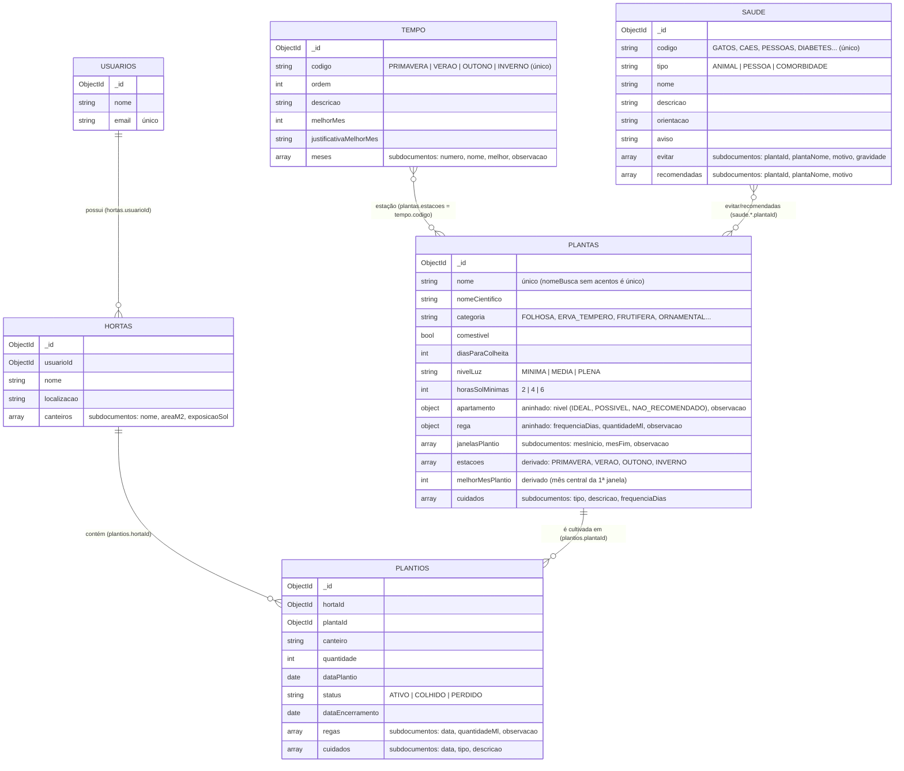

# Modelo de dados (MongoDB)

Banco: `ecohorta`. Seis coleções relacionadas por referências (`ObjectId`) e por chave natural,
com subdocumentos e listas embutidos onde faz sentido.



## Exemplos de documentos

### `plantas` — documentos aninhados + listas de subdocumentos
```json
{
  "_id": { "$oid": "665f0c2e8a1b2c3d4e5f6a01" },
  "nome": "Alface",
  "nomeBusca": "alface",
  "nomeCientifico": "Lactuca sativa",
  "categoria": "FOLHOSA",
  "comestivel": true,
  "diasParaColheita": 45,
  "luminosidade": "Sol pleno em clima ameno; meia sombra no calor",
  "nivelLuz": "MEDIA",
  "horasSolMinimas": 4,
  "apartamento": { "nivel": "IDEAL", "observacao": "Cresce bem em jardineiras ou vasos largos na janela" },
  "rega": { "frequenciaDias": 1, "quantidadeMl": 250, "observacao": "Regas leves e frequentes" },
  "janelasPlantio": [
    { "mesInicio": 3, "mesFim": 8, "observacao": "Melhor época, clima ameno" },
    { "mesInicio": 9, "mesFim": 2, "observacao": "Verão: usar variedades resistentes ao calor e meia sombra" }
  ],
  "estacoes": ["PRIMAVERA", "VERAO", "OUTONO", "INVERNO"],
  "melhorMesPlantio": 5,
  "cuidados": [
    { "tipo": "ADUBACAO", "descricao": "Adubação orgânica rica em nitrogênio", "frequenciaDias": 15 },
    { "tipo": "PRAGAS",   "descricao": "Verificar lesmas e caracóis",          "frequenciaDias": 7 },
    { "tipo": "SOLO",     "descricao": "Solo rico em matéria orgânica e bem drenado", "frequenciaDias": 0 }
  ]
}
```
> `mesInicio > mesFim` indica janela que cruza a virada do ano (set → fev).
> `frequenciaDias = 0` é só orientação (não gera tarefa periódica).
> `nomeBusca`, `estacoes`, `melhorMesPlantio` e `horasSolMinimas` são **derivados** e gravados para permitir consultas/índices.

**Níveis de luz** (`nivelLuz`): `MINIMA` = pouca luz (até ~3 h de sol ou luz indireta); `MEDIA` = luz média, **cerca de meio dia
de sol** (4–5 h); `PLENA` = **sol pleno, o dia todo** (6 h ou mais).

### `tempo` — estações, melhor mês e relação com as plantas
```json
{
  "_id": { "$oid": "665f0c2e8a1b2c3d4e5f6e01" },
  "codigo": "PRIMAVERA",
  "nome": "Primavera",
  "ordem": 1,
  "descricao": "Temperaturas subindo e chuvas voltando...",
  "melhorMes": 10,
  "justificativaMelhorMes": "Outubro reúne solo já aquecido, temperaturas amenas e chuvas regulares...",
  "meses": [
    { "numero": 9,  "nome": "Setembro", "melhor": false, "observacao": "Ainda pode haver frio e geada tardia..." },
    { "numero": 10, "nome": "Outubro",  "melhor": true,  "observacao": "Clima ideal: temperatura amena, solo aquecido e chuva regular" },
    { "numero": 11, "nome": "Novembro", "melhor": false, "observacao": "Calor crescente; reforçar a rega..." }
  ]
}
```
> A relação é por **chave natural**: `plantas.estacoes` guarda os códigos de `tempo.codigo`. O `$lookup` funciona
> mesmo com o campo da planta sendo um array (ver `docs/consultas-mongosh.js`).
> Melhores meses (Centro-Sul): primavera = outubro, verão = dezembro, outono = abril, inverno = agosto.

### `saude` — toxicidade e condições de saúde (listas de subdocumentos com referências a `plantas`)
```json
{
  "_id": { "$oid": "665f0c2e8a1b2c3d4e5f6f01" },
  "codigo": "GATOS",
  "tipo": "ANIMAL",
  "nome": "Gatos",
  "descricao": "Gatos mordiscam folhas e têm dificuldade para eliminar certas toxinas...",
  "orientacao": "Mantenha as plantas perigosas fora do alcance...",
  "aviso": "Informação educativa. Não substitui a orientação de médico, nutricionista ou veterinário.",
  "evitar": [
    { "plantaId": { "$oid": "665f0c2e8a1b2c3d4e5f6a10" }, "plantaNome": "Cebola",
      "motivo": "Cebola, alho e parentes (Allium) danificam as hemácias e causam anemia...", "gravidade": "GRAVE" },
    { "plantaId": { "$oid": "665f0c2e8a1b2c3d4e5f6a11" }, "plantaNome": "Lírio",
      "motivo": "Qualquer parte do lírio... pode causar insuficiência renal aguda em gatos", "gravidade": "GRAVE" }
  ],
  "recomendadas": [
    { "plantaId": { "$oid": "665f0c2e8a1b2c3d4e5f6a12" }, "plantaNome": "Manjericão",
      "motivo": "Considerada não tóxica para cães e gatos; ofereça com moderação e supervisão", "gravidade": null }
  ]
}
```
Registros carregados (13):

| `tipo` | `codigo` | Conteúdo |
|---|---|---|
| `ANIMAL` | `GATOS`, `CAES` | plantas tóxicas (com gravidade) e plantas consideradas seguras |
| `PESSOA` | `PESSOAS` | plantas que fazem mal ao consumo (cruas, partes verdes, ornamentais) |
| `COMORBIDADE` | `RESPIRATORIO`, `ALERGIA_POLEN`, `HIPERTENSAO`, `DIABETES`, `DOENCA_RENAL`, `ANTICOAGULANTE`, `GRAVIDEZ_LACTACAO`, `GASTRITE_REFLUXO`, `TIREOIDE`, `HEPATICA` | o que **evitar** (com gravidade) e o que **recomendar** |

**Gravidade** — toxicidade: `LEVE` = incômodo digestivo/irritação, `MODERADA` = intoxicação provável, `GRAVE` = risco de vida.
Condições de saúde: `LEVE` = moderar a porção, `MODERADA` = limitar bastante, `GRAVE` = evitar.

### `hortas` — referência ao usuário + canteiros embutidos
```json
{
  "_id": { "$oid": "665f0c2e8a1b2c3d4e5f6b01" },
  "usuarioId": { "$oid": "665f0c2e8a1b2c3d4e5f6c01" },
  "nome": "Horta do Quintal",
  "localizacao": "Maringá - PR",
  "canteiros": [
    { "nome": "Canteiro Sol",    "areaM2": 4.0, "exposicaoSol": "Sol pleno" },
    { "nome": "Canteiro Sombra", "areaM2": 2.5, "exposicaoSol": "Meia sombra" }
  ]
}
```

### `plantios` — referências para horta e planta + histórico embutido
```json
{
  "_id": { "$oid": "665f0c2e8a1b2c3d4e5f6d01" },
  "hortaId":  { "$oid": "665f0c2e8a1b2c3d4e5f6b01" },
  "plantaId": { "$oid": "665f0c2e8a1b2c3d4e5f6a05" },
  "canteiro": "Canteiro Sol",
  "quantidade": 4,
  "dataPlantio": { "$date": "2026-10-21T00:00:00Z" },
  "status": "ATIVO",
  "dataEncerramento": null,
  "regas": [
    { "data": { "$date": "2026-11-07T00:00:00Z" }, "quantidadeMl": 1000, "observacao": "Rega da manhã" }
  ],
  "cuidados": [
    { "data": { "$date": "2026-11-01T00:00:00Z" }, "tipo": "ADUBACAO", "descricao": "Adubar com composto ou NPK a cada 15 dias" }
  ]
}
```

## Regras de cálculo (tarefas do dia)
- **Rega:** próxima = última rega + `rega.frequenciaDias`; sem nenhuma rega, é devida na data do plantio.
- **Cuidado periódico:** próximo = último cuidado do mesmo tipo (ou a data do plantio) + `frequenciaDias`.
- **Colheita:** `dataPlantio + diasParaColheita` (só para plantas `comestivel = true`; ornamentais não têm colheita).
- Tarefa com data anterior a hoje é marcada como **atrasada**. Plantios `COLHIDO`/`PERDIDO` não geram tarefas.

## Índices
| Coleção | Índice | Motivo |
|---|---|---|
| `usuarios` | `email` (único) | login e unicidade |
| `plantas` | `nomeBusca` (único) | busca sem acentos e unicidade no catálogo |
| `plantas` | `estacoes`, `categoria`, `nivelLuz`, `apartamento.nivel` | filtros do catálogo (multikey em `estacoes`) |
| `tempo` | `codigo` (único) | uma estação por código |
| `saude` | `codigo` (único) | um registro por grupo/condição |
| `saude` | `evitar.plantaId`, `recomendadas.plantaId` | "o que se sabe sobre esta planta?" (multikey em listas embutidas) |
| `hortas` | `usuarioId` | listar hortas do usuário |
| `plantios` | `hortaId`, `plantaId` | listar plantios da horta; junções |
