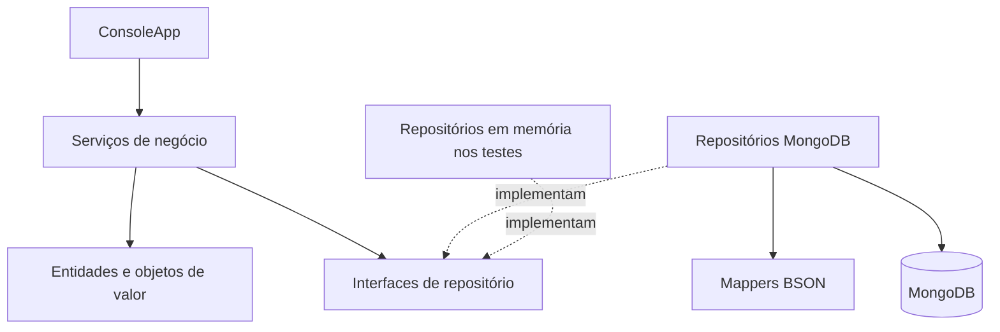
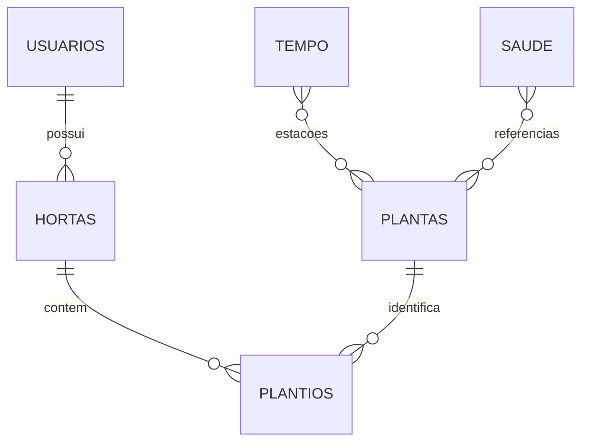
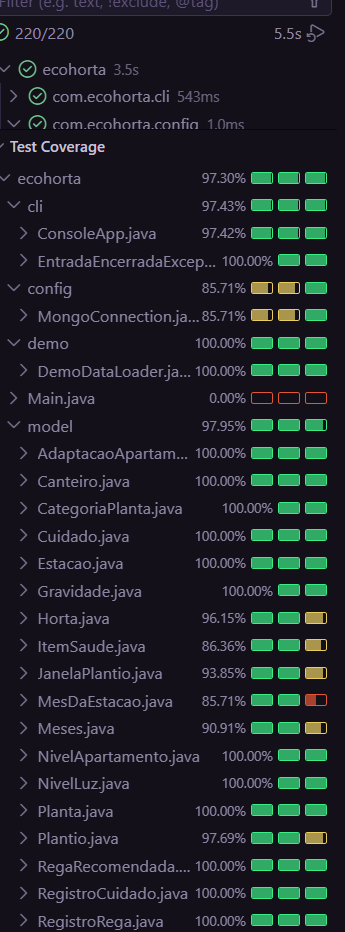
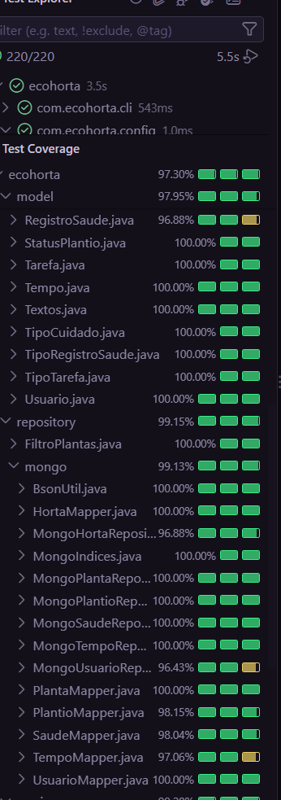
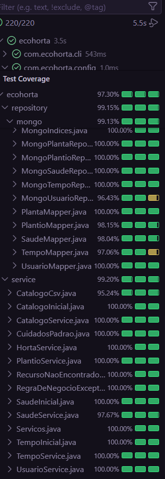

# 🌱 EcoHorta

**Assistente de horta caseira em Java e MongoDB**  
AEP — Atividade de Estudo Programada · Engenharia de Software · 2026.2 · Segunda entrega

O EcoHorta ajuda a consultar plantas, organizar hortas e canteiros e acompanhar plantios, regas e cuidados pelo terminal. Esta documentação reúne instalação, arquitetura, banco de dados, testes, evolução e quadro de tarefas em um único arquivo.

**Versão da aplicação:** 2.0.0. **Código analisado:** [`d4d99fd`](https://github.com/SamyChagas20/AEP_ESOFT/commit/d4d99fd), consultado em 13/11/2026.  
**Repositório:** [SamyChagas20/AEP_ESOFT](https://github.com/SamyChagas20/AEP_ESOFT).

**Sumário**

1. [Apresentação, instalação e execução](#parte-1)
2. [Documentação técnica e modelo do banco](#parte-2)
3. [Testes, cobertura e prints](#parte-3)
4. [Evolução entre as entregas](#parte-4)
5. [Quadro de tarefas retrospectivo](#parte-5)

<a id="parte-1"></a>

## 1. Apresentação, instalação e execução

### Problema, público e objetivo

Quem começa uma horta doméstica precisa organizar informações sobre época de plantio, luminosidade, frequência de rega e cuidados. Anotações dispersas dificultam acompanhar o que já foi realizado e o que está pendente.

O EcoHorta reúne essas informações e o histórico de cultivo em uma aplicação para iniciantes, moradores de casas ou apartamentos e pessoas interessadas em pequenas hortas. Seu objetivo é apoiar o planejamento e a continuidade do cultivo doméstico.

**Alinhamento proposto nesta documentação: ODS 2 — Fome Zero e Agricultura Sustentável.** A PoC contribui, em escala doméstica e educativa, para o acesso a informações de cultivo e para a organização de hortas. Não foram medidos impactos sobre produção de alimentos, redução de perdas ou consumo de água. A equipe deve confirmar que este enquadramento corresponde ao ODS definido na primeira entrega.

### Funcionalidades implementadas

- Entrada e cadastro por e-mail, sem autenticação por senha.
- Criação de hortas por usuário e inclusão de canteiros.
- Catálogo inicial de **242 plantas**: cinco definidas em Java e 237 carregadas de CSV.
- Busca por nome e filtros de categoria, estação, luminosidade e adaptação a apartamento.
- Consulta às quatro estações, aos meses de plantio e às sugestões para o mês atual.
- Início de plantios vinculados à horta, ao canteiro e à planta do catálogo.
- Registro de regas e cuidados, com histórico por plantio.
- Listagem de tarefas de rega, cuidados periódicos e previsão de colheita.
- Encerramento de plantios como colhidos ou perdidos e resumo por situação.
- Consulta a registros educativos de saúde e toxicidade associados às plantas.
- Carga de dados de demonstração para explorar o fluxo.

A interface atual é de terminal. Ela não oferece um CRUD administrativo completo de espécies; o catálogo é carregado pelos recursos e serviços da aplicação.

### Tecnologias

| Componente | Tecnologia / versão declarada |
|---|---|
| Linguagem | Java 17 |
| Build e dependências | Apache Maven |
| Persistência | MongoDB; imagem `mongo:7` no Compose |
| Driver | MongoDB Java Sync Driver 4.11.1 |
| Testes | JUnit 5.10.2 |
| Cobertura | JaCoCo 0.8.11 |
| Empacotamento | Maven Shade Plugin; JAR com dependências |

### Instalação e execução

Instale JDK 17, Maven e um MongoDB acessível. Docker com Compose é opcional, utilizado nos comandos abaixo para iniciar o banco. Confira `java -version` e `mvn -version`.

```bash
git clone https://github.com/SamyChagas20/AEP_ESOFT.git
cd AEP_ESOFT/EcoHorta
docker compose up -d
mvn compile exec:java
```

**Os comandos Maven e Docker Compose devem ser executados em `AEP_ESOFT/EcoHorta`, onde estão `pom.xml` e `docker-compose.yml`.** Caso já use MongoDB local ou Atlas, não é necessário iniciar o contêiner.

O Compose publica a porta 27017 e mantém os dados no volume `ecohorta-dados`. Aguarde o banco iniciar antes de abrir a aplicação. Para conferir o contêiner: `docker compose ps`.

| Variável de ambiente | Valor padrão | Finalidade |
|---|---|---|
| `MONGODB_URI` | `mongodb://localhost:27017` | Conexão com o servidor |
| `MONGODB_DB` | `ecohorta` | Banco usado pela aplicação |

Exemplo no PowerShell:

```powershell
$env:MONGODB_URI="mongodb://localhost:27017"
$env:MONGODB_DB="ecohorta"
mvn compile exec:java
```

Exemplo no Bash:

```bash
export MONGODB_URI='mongodb://localhost:27017'
export MONGODB_DB='ecohorta'
mvn compile exec:java
```

Para usar Atlas, configure a URI do cluster, um usuário com permissão no banco e o acesso de rede. Não publique credenciais no repositório.

Para gerar e executar o JAR, com MongoDB acessível:

```bash
mvn clean verify -Dmongo.obrigatorio=true
java -jar target/ecohorta.jar
```

### Primeiro uso

1. No menu inicial, escolha **6 — Carregar dados de demonstração e entrar**.
2. No menu do usuário, escolha **5 — Ver plantios da horta** ou **8 — Tarefas de hoje**.
3. Registre uma rega pela opção **6** ou um cuidado pela opção **7**.
4. Consulte as tarefas novamente e observe a atualização.
5. Use **9 — Encerrar plantio** e **10 — Resumo da horta** para demonstrar os estados.

Para começar sem os dados de demonstração, escolha **1 — Entrar / cadastrar-se** no menu inicial, crie uma horta, adicione um canteiro e inicie um plantio. Os números das opções mudam entre o menu inicial e o menu do usuário.

<a id="parte-2"></a>

## 2. Documentação técnica e modelo do banco

### Arquitetura e organização

| Local em `src/main/java/com/ecohorta` | Responsabilidade | Exemplos |
|---|---|---|
| `Main.java` | Composição das dependências e inicialização | Conecta, cria índices, carrega dados e abre o menu |
| `cli` | Entrada e saída no terminal | `ConsoleApp`, tratamento de entradas inválidas |
| `model` | Entidades, objetos de valor e validações | `Usuario`, `Horta`, `Planta`, `Plantio`, `Canteiro` |
| `service` | Casos de uso e regras de negócio | `HortaService`, `PlantioService`, `CatalogoService` |
| `repository` | Contratos de persistência | `HortaRepository`, `PlantioRepository` |
| `repository/mongo` | Persistência e mapeamento BSON | `MongoPlantioRepository`, `PlantioMapper`, `MongoIndices` |
| `config` | Configuração e ciclo de vida da conexão | `MongoConnection` |
| `demo` | Construção de dados de demonstração | `DemoDataLoader` |

O catálogo CSV fica em `src/main/resources/catalogo/plantas.csv`. Os testes estão em `src/test/java/com/ecohorta`, incluindo repositórios em memória em `support`.



#### Orientação a objetos

As entidades encapsulam estado e operações do domínio. Objetos de valor, como canteiros e registros de cuidados, representam dados associados. Os serviços dependem de interfaces de repositório recebidas pelo construtor, permitindo usar implementações MongoDB na aplicação e implementações em memória nos testes. Essa substituição emprega polimorfismo por interfaces.

O `Clock` é recebido por dependência nos fluxos temporais. Isso permite testar tarefas e datas sem depender exclusivamente do dia em que o teste é executado. A aplicação usa o relógio do sistema.

#### Inicialização

`Main` lê a configuração, executa um `ping` no MongoDB, cria índices e monta os seis repositórios. Em seguida, `Servicos.carregarDadosIniciais()` inicializa catálogo, estações e registros de saúde. O terminal é iniciado após essas etapas. Falhas de conexão são informadas e encerram a aplicação.


### Casos de uso

| ID | Caso de uso | Resultado |
|---|---|---|
| UC01 | Entrar ou cadastrar por e-mail | Usuário identificado ou criado |
| UC02 | Consultar catálogo e ficha de planta | Espécies e orientações exibidas |
| UC03 | Consultar estações e mês atual | Plantas compatíveis com o período |
| UC04 | Criar horta e adicionar canteiro | Estrutura de cultivo vinculada ao usuário |
| UC05 | Iniciar plantio | Cultivo relacionado à horta e à espécie |
| UC06 | Registrar rega ou cuidado | Histórico atualizado no plantio |
| UC07 | Consultar tarefas | Pendências calculadas por data |
| UC08 | Encerrar plantio | Estado alterado para colhido ou perdido |
| UC09 | Consultar resumo | Contagem de plantios por situação |
| UC10 | Consultar informações de saúde | Registros educativos associados às plantas |

Não há autenticação segura: conhecer o e-mail permite entrar no cadastro correspondente. Não há comprovação de identidade nem autorização robusta para uso público.


### Regras de negócio

| Regra | Comportamento implementado |
|---|---|
| Vínculos do plantio | Horta, planta e canteiro devem existir antes de iniciar o cultivo |
| Datas de registro | O serviço rejeita datas futuras de início de plantio, rega e cuidado |
| Próxima rega | Sem histórico, vence na data do plantio; depois, última rega mais frequência da espécie |
| Quantidade de rega | Na ausência de quantidade informada ao serviço, utiliza o valor cadastrado para a planta |
| Cuidados periódicos | Próxima data calculada pelo último cuidado do tipo ou pela data do plantio, mais a frequência |
| Orientações não periódicas | Cuidados de frequência zero não geram tarefas periódicas |
| Colheita | Previsão calculada pela data do plantio mais dias para colheita; tarefa gerada apenas para plantas comestíveis |
| Tarefas | Considera vencimentos até o dia consultado; datas anteriores são sinalizadas como atrasadas |
| Plantios encerrados | Não geram tarefas de cultivo |
| Ordenação | Tarefas por data prevista, nome da planta e tipo |
| Busca textual | Nome normalizado para busca; metacaracteres são tratados como texto no filtro |

As regras estão distribuídas entre `model` e `service`, especialmente `Plantio` e `PlantioService`. Consultar o catálogo e registrar uma tarefa não representa medição automática de umidade ou crescimento.


### Banco de dados NoSQL

Banco padrão: `ecohorta`. A aplicação utiliza seis coleções:

| Coleção | Conteúdo | Relacionamentos e dados complexos |
|---|---|---|
| `usuarios` | Nome e e-mail | Referenciada por `hortas.usuarioId` |
| `hortas` | Horta e localização | Referência ao usuário e lista embutida `canteiros` |
| `plantas` | Catálogo das espécies | Objetos `rega` e `apartamento`; listas de janelas e cuidados |
| `plantios` | Cultivos e seus estados | Referências à horta e planta; históricos `regas` e `cuidados` |
| `tempo` | Estações e meses | `codigo` relacionado a `plantas.estacoes`; lista `meses` |
| `saude` | Grupos e condições cadastradas | Listas `evitar` e `recomendadas` com referências às plantas |

As referências de entidades são armazenadas como `ObjectId`; as estações também usam uma relação por chave natural. Dados de ciclo de vida associado, como registros de rega, ficam embutidos no plantio. As referências não equivalem a chaves estrangeiras impostas pelo MongoDB: a aplicação e os testes precisam assegurar a coerência dos vínculos.

`MongoIndices` cria índices únicos para e-mail, nome normalizado de planta e códigos de tempo e saúde. Outros índices auxiliam filtros por estação, categoria, luz, apartamento e referências. Há agregação por status nos repositórios e exemplos de `$lookup` nas consultas e nos testes.

Os mappers convertem entidades em documentos BSON e vice-versa. Datas do domínio são convertidas para BSON pelo `BsonUtil`. Um exemplo de documento e as relações principais estão apresentados abaixo.


### Decisões e limitações

- Interface de terminal mantém o escopo acadêmico concentrado nas regras, persistência e testes.
- Interfaces de repositório separam o domínio da implementação MongoDB.
- Não há API HTTP, interface web, sensores, previsão meteorológica ou notificações externas.
- As tarefas são calculadas na consulta; não há agendador executando ações automaticamente.
- Dados de cultivo e saúde são educativos, não validados individualmente nesta revisão documental.
- A versão atual modifica o esquema anterior; não há rotina de migração automática documentada para os dados da primeira entrega. Para demonstração, prefira uma base de desenvolvimento própria.
- O arquivo de CI está em `EcoHorta/.github/workflows/ci.yml`; esta documentação não presume execução automática nem apresenta resultados do GitHub Actions como verificados.


### Relações entre as coleções



`hortas.usuarioId` referencia o usuário; `plantios.hortaId` e `plantios.plantaId` referenciam a horta e a espécie. `plantas.estacoes` guarda códigos de `tempo.codigo`. As listas de saúde guardam `plantaId`.

### Exemplo de documento de plantio

Exemplo ilustrativo em Extended JSON, com identificadores fictícios. Os históricos pertencem ao plantio e ficam embutidos no documento.

```json
{
  "_id": { "$oid": "665f0c2e8a1b2c3d4e5f6d01" },
  "hortaId": { "$oid": "665f0c2e8a1b2c3d4e5f6b01" },
  "plantaId": { "$oid": "665f0c2e8a1b2c3d4e5f6a05" },
  "canteiro": "Canteiro Sol",
  "quantidade": 4,
  "dataPlantio": { "$date": "2026-10-21T00:00:00Z" },
  "status": "ATIVO",
  "dataEncerramento": null,
  "regas": [
    {
      "data": { "$date": "2026-11-07T00:00:00Z" },
      "quantidadeMl": 1000,
      "observacao": "Rega da manhã"
    }
  ],
  "cuidados": [
    {
      "data": { "$date": "2026-11-01T00:00:00Z" },
      "tipo": "ADUBACAO",
      "descricao": "Adubação registrada"
    }
  ]
}
```

<a id="parte-3"></a>

## 3. Testes, cobertura e prints

### Critério da AEP e configuração

A AEP exige testes relevantes e executáveis, cobertura mínima de 70% sobre o código entregue e evidência reproduzível. O `pom.xml` utiliza JUnit 5.10.2 e JaCoCo 0.8.11 e configura:

| Propriedade | Valor |
|---|---|
| Unidade de avaliação | `BUNDLE` — conjunto da aplicação |
| Contador | `LINE` — linhas executáveis |
| Métrica | `COVEREDRATIO` — proporção coberta |
| Mínimo | `0.70` |
| Fase de bloqueio | `verify` |
| Exclusões manuais | Nenhuma classe ou pacote de produção excluído na configuração consultada |

Código de teste, dependências externas e CSV não integram o denominador das classes de produção. O `Main.java` está incluído, com cobertura zero no relatório existente. Não é exigido pelo enunciado um mínimo de 70% em cada arquivo.

### Evidências disponíveis

Esta revisão documental consultou o código e o relatório existentes no commit `d4d99fd`, além dos prints enviados pela equipe. **Não houve nova execução dos testes nesta revisão.**

#### Relatório JaCoCo versionado

Os valores abaixo foram extraídos dos contadores globais de [jacoco.xml versionado](https://github.com/SamyChagas20/AEP_ESOFT/blob/d4d99fd/EcoHorta/docs/cobertura/jacoco.xml):

| Métrica | Cobertos | Total | Percentual |
|---|---:|---:|---:|
| Linhas | 1.907 | 1.942 | **98,20%** |
| Instruções | 12.285 | 12.452 | 98,66% |
| Ramos | 659 | 699 | 94,28% |

O mínimo do build é aplicado a **linhas**. Instruções e ramos são métricas complementares. A cobertura de linhas supera o mínimo em 28,20 pontos percentuais.

A documentação previamente versionada registra uma execução de 220 testes aprovados, sendo 204 unitários/de fluxo e 16 de integração. O código consultado contém 220 métodos anotados com `@Test`, dos quais 16 estão na classe de integração. A contagem estática confirma o tamanho da suíte, mas não substitui sua execução.

#### Prints fornecidos pela equipe

Os três prints apresentam **220/220 testes** e o indicador geral **97,30%**. Eles documentam uma execução no ambiente da equipe, mas não expõem informações suficientes para determinar por que o percentual difere do relatório JaCoCo. Não se atribui essa diferença a uma causa não verificada.

<details open>
<summary><strong>Print 1 — Resultado geral e modelos</strong></summary>



</details>

<details>
<summary><strong>Print 2 — Modelos e repositórios</strong></summary>



</details>

<details>
<summary><strong>Print 3 — Repositórios e serviços</strong></summary>



</details>

Use o relatório gerado a partir da versão final para registrar a cobertura de entrega. Não apresente o valor do print como se fosse necessariamente a métrica `LINE` do JaCoCo.

### Estratégia e cenários

| Grupo | Cenários verificados pelo código de teste | Arquivos de referência |
|---|---|---|
| Entidades | Validações de dados, estados, janelas, regas e cuidados | `model/PlantioTest.java`, `model/HortaTest.java`, `model/PlantaTest.java` |
| Catálogo | Leitura do CSV, entradas inválidas e filtros | `service/CatalogoCsvTest.java`, `service/CatalogoServiceTest.java` |
| Serviços | Criação de hortas, plantios, tarefas e encerramento | `service/HortaServiceTest.java`, `service/PlantioServiceTest.java` |
| Saúde e estações | Consultas e composição de perfis e períodos | `service/SaudeServiceTest.java`, `service/TempoServiceTest.java` |
| Terminal | Entradas inválidas, menus e fluxo de uso | `cli/ConsoleAppTest.java` |
| BSON | Conversão de documentos e tipos | `repository/mongo/MappersTest.java`, `BsonUtilTest.java` |
| Integração | Persistência, índices únicos, vínculos, listas, filtros e agregações | `repository/mongo/MongoRepositoriosIntegracaoTest.java` |

Os caminhos da última coluna são relativos a `src/test/java/com/ecohorta`. Repositórios em memória apoiam os testes isolados; a classe de integração utiliza MongoDB real.

### Reprodução completa

Pré-requisitos: JDK 17, Maven e MongoDB acessível. A partir da raiz do repositório:

```bash
cd EcoHorta
docker compose up -d
mvn clean verify -Dmongo.obrigatorio=true
```

Se utilizar um servidor já iniciado, omita o comando Docker. Configure `MONGODB_URI` se ele não estiver em `mongodb://localhost:27017`. Aguarde o servidor estar acessível antes de executar Maven.

A integração cria um banco próprio com nome `ecohorta_teste_<timestamp>`, limpa esse banco entre os testes e o remove ao finalizar. Utilize uma instância de desenvolvimento/testes com permissão para essas operações. O nome desse banco temporário não é definido por `MONGODB_DB`.

#### Saídas a conferir

| Arquivo / pasta, relativo a `EcoHorta` | Finalidade |
|---|---|
| `target/surefire-reports/` | Resultados JUnit, falhas, erros e testes ignorados |
| `target/site/jacoco/index.html` | Relatório visual de cobertura |
| `target/site/jacoco/jacoco.xml` | Contadores para verificação automatizada |
| `target/site/jacoco/jacoco.csv` | Contadores tabulares |

Verifique `BUILD SUCCESS`, ausência de falhas/erros e a execução da integração. Abra o HTML no navegador. Para registrar a versão final, copie os arquivos de `target/site/jacoco/` para `docs/cobertura/`, preservando todos os recursos, e atualize os percentuais desta documentação se houver mudança.

#### Execução sem exigir MongoDB

```bash
mvn clean verify
```

Sem MongoDB acessível, a suíte de integração é abortada por uma condição do JUnit. Isso não significa que os testes de integração passaram. Use a opção obrigatória para a evidência completa da entrega.

### Alcance da evidência

Cobertura indica execução de código, não ausência de defeitos. A avaliação também depende da relevância das asserções, da execução funcional e dos demais entregáveis. O relatório versionado e os prints não comprovam uma execução futura: após alterar o código, execute novamente o comando e atualize as evidências.

<a id="parte-4"></a>

## 4. Evolução entre as entregas

Comparação baseada no histórico disponível em [AEP_ESOFT](https://github.com/SamyChagas20/AEP_ESOFT), consultado em 13/11/2026.

### Versões de referência

| Referência | Commit | Identificação no histórico |
|---|---|---|
| Base anterior às atualizações da segunda entrega | [`e65fc14`](https://github.com/SamyChagas20/AEP_ESOFT/commit/e65fc14) | `Update README.md`, 11/09/2026 |
| Atualização da segunda entrega | [`457ab37`](https://github.com/SamyChagas20/AEP_ESOFT/commit/457ab37) | `Atualizado 2 entrega`, 13/11/2026 |
| Código atual analisado | [`d4d99fd`](https://github.com/SamyChagas20/AEP_ESOFT/commit/d4d99fd) | `Atualizado`, 13/11/2026 |

A base de setembro representa o estado anterior encontrado no repositório; a equipe deve confirmar se corresponde exatamente ao commit formalmente entregue na primeira etapa. Os commits indicam registros de versionamento, não as datas de início e término de cada tarefa.

### Comparação verificável

| Aspecto | Estado anterior (`e65fc14`) | Estado atual (`d4d99fd`) |
|---|---|---|
| Persistência | `PlantaDAO` operava uma coleção denominada `EcoHorta` | Seis coleções: usuários, hortas, plantas, plantios, tempo e saúde |
| Catálogo | Cinco plantas iniciais e cadastro pelo protótipo | Cinco definições Java mais 237 entradas CSV; filtros e fichas ampliadas |
| Rega | Última rega vinculada ao registro da planta | Histórico de regas vinculado a cada plantio |
| Organização do cultivo | Modelo centrado na planta | Usuários, hortas, canteiros e plantios relacionados |
| Arquitetura | `Main`, DAO, conexão, entidade e serviço | CLI separada, modelos, serviços, interfaces, mappers e infraestrutura MongoDB |
| Planejamento | Consulta de plantas que precisavam de rega | Tarefas de rega, cuidados periódicos e previsão de colheita |
| Dados auxiliares | Orientações textuais no registro da planta | Estações, meses, luminosidade, apartamento e registros educativos de saúde |
| Testes | Arquivo `EcoHortaTest.java` | Suítes de modelo, serviços, terminal, BSON, configuração, demonstração e integração |
| Evidência de cobertura | Não foi adotado percentual anterior nesta comparação | Relatório JaCoCo versionado e bloqueio de 70% de linhas |

### Como reproduzir a comparação

Na raiz do repositório:

```bash
git log --oneline --date=short
git diff --stat e65fc14 d4d99fd
git diff e65fc14 d4d99fd -- EcoHorta/src EcoHorta/pom.xml
```

### Identificação final

Esta documentação é um complemento posterior à análise do commit `d4d99fd`. Após publicar este README, registre o novo commit ou crie uma tag de segunda entrega. Não use o hash acima para afirmar que ele já contém o README atualizado.

<a id="parte-5"></a>

## 5. Quadro de tarefas retrospectivo

**Organizado em 13/11/2026 para a segunda entrega.**

Este quadro foi reconstruído ao final do desenvolvimento, com base no código e nos artefatos disponíveis. Não havia quadro mantido durante a execução. Portanto, ele organiza o trabalho realizado e as pendências atuais, sem representar um histórico de movimentação de cartões ou comprovar adoção prévia de Scrum/Kanban.

### Organização do quadro

As colunas são **A fazer**, **Em revisão** e **Concluído**. Na elaboração deste documento, “Concluído” indica implementação ou artefato localizado, não homologação integral. Não foram atribuídos responsáveis individuais nem datas retroativas sem registro.

| A fazer | Em revisão | Concluído |
|---|---|---|
| T13 — Gravar e publicar o vídeo | T10 — Conferir evidência final de testes | T01 — Configurar projeto Java/Maven |
| T14 — Registrar versão final | T11 — Revisar documentação e ODS | T02 — Integrar persistência MongoDB |
| T15 — Preencher identificação acadêmica | T12 — Validar este quadro retrospectivo | T03 — Implementar usuários, hortas e canteiros |
| — | — | T04 — Expandir catálogo e filtros |
| — | — | T05 — Implementar plantios e históricos |
| — | — | T06 — Calcular tarefas e encerramentos |
| — | — | T07 — Implementar estações e saúde |
| — | — | T08 — Criar fluxo de terminal e demonstração |
| — | — | T09 — Implementar testes e regra de cobertura |

### Detalhamento e critérios de conclusão

| ID | Atividade | Evidência ou condição de conclusão |
|---|---|---|
| T01 | Configurar dependências, compilação e JAR | `pom.xml`, Java 17, driver, JUnit, JaCoCo e Shade |
| T02 | Persistir documentos, relações e índices | `repository/mongo`, `MongoConnection`, `MongoIndices` |
| T03 | Modelar usuários, hortas e canteiros | Entidades e serviços correspondentes |
| T04 | Expandir catálogo e consultas | `CatalogoInicial`, `CatalogoCsv`, `FiltroPlantas` e CSV |
| T05 | Registrar plantios, regas e cuidados | `Plantio`, `PlantioService` e `PlantioMapper` |
| T06 | Calcular pendências e encerrar cultivos | `tarefasDoDia`, estados e resumo por status |
| T07 | Disponibilizar estações e registros educativos | `TempoService`, `SaudeService` e respectivas coleções |
| T08 | Disponibilizar interação e demonstração | `ConsoleApp` e `DemoDataLoader` |
| T09 | Implementar suíte e limiar de cobertura | `src/test/java`, configuração `LINE ≥ 70%` e relatório existente |
| T10 | Conferir evidências sobre a versão final | Executar `mvn clean verify -Dmongo.obrigatorio=true`; atualizar relatório e prints se necessário |
| T11 | Revisar e publicar documentação | Conferir ODS, links, instruções e resultados; publicar este README e a pasta `imagens` |
| T12 | Validar quadro retrospectivo | Equipe revisar atividades e atualizar estados sem inventar histórico |
| T13 | Gravar demonstração de 3 a 5 minutos | Vídeo acessível com evolução, arquitetura, uso, testes e resultados |
| T14 | Identificar segunda entrega | Informar commit final ou tag/release no material submetido |
| T15 | Preencher dados acadêmicos | Nomes, RAs, curso, série, título, GitHub e link do vídeo |

### Uso a partir desta organização

Ao executar uma pendência, mova-a para “Em revisão”; após conferir a evidência, mova-a para “Concluído”. O quadro pode ser mantido neste Markdown ou transposto para um quadro visual, preservando sua identificação como retrospectivo.

A aceitação deste quadro no critério de metodologia depende da avaliação docente. Ele não substitui evidências de acompanhamento durante o desenvolvimento que não foram produzidas.

